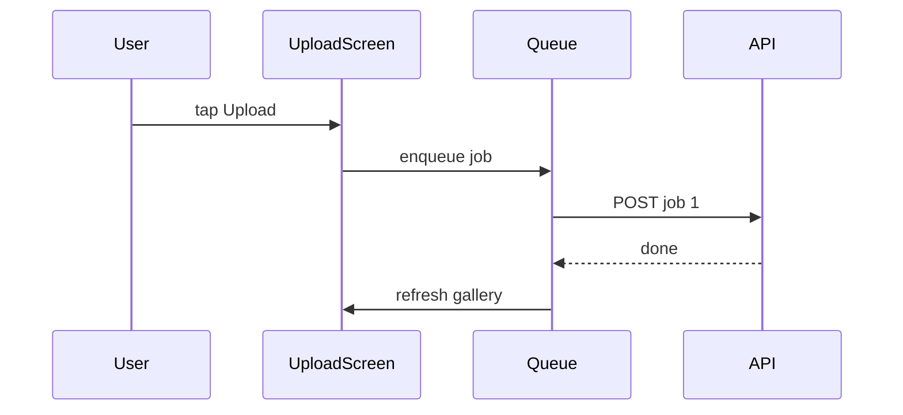

# Plan template

Two worked examples. Copy the one closest in size and replace the content.

- **Example A** is a feature. Every optional section appears because each trigger applies: the user settled choices (Locked decisions), the change is user-visible (Behavior contract), part of it exists (Already shipped), and approaches were compared (Rejected alternatives).
- **Example B** is a small fix. It has only the required sections. Most plans look more like B than A.

## Example A: feature with every optional section

A mobile app adds a client-side upload queue so the Upload button never blocks.

````markdown
---
name: Upload queue
overview: Queue photo uploads on the client so Upload stays tappable, jobs run one at a time, and the gallery shows placeholders until each upload lands.
todos:
  - id: queue-model
    content: Add UploadJob type and FIFO queue state in UploadScreen
    status: pending
  - id: worker
    content: Serial worker effect that posts one job at a time and survives failures
    status: pending
  - id: gallery-ui
    content: Placeholder cards for queued and running jobs; dismissible error cards
    status: pending
  - id: docs
    content: Note the queue contract in AGENTS.md
    status: pending
  - id: verify
    content: Run lint, typecheck, build; give the manual device checklist
    status: pending
---

# Upload queue

## Current state

- [`src/screens/UploadScreen.tsx`](src/screens/UploadScreen.tsx) uses one
  `busy` flag. Upload shows "Working..." and is disabled until the request ends.
- [`src/api/upload.ts`](src/api/upload.ts) posts one file per call.
- No retry or queue exists. `unverified`: behavior when the app is backgrounded.

## Locked decisions

- Client-only queue in component state. No server queue, no persistence across
  restarts.
- One request in flight at a time (first in, first out).
- Each tap snapshots the current form fields into the job.

## Behavior contract

- Upload stays enabled while jobs run; it is disabled only when nothing is
  selected.
- Each queued job shows a placeholder card in the gallery.
- A failed job shows an error card with Dismiss, and the queue continues.
- Jobs finish in the order they were queued.

## Already shipped (verify, do not rebuild)

| Item | Where | Status |
| --- | --- | --- |
| Single-file upload API | `src/api/upload.ts` | Done, reuse as is |
| Gallery refresh after upload | `useGallery().refresh` | Done |

## Implementation

1. **Job model** in `src/screens/UploadScreen.tsx`: `UploadJob { id, fields, status }`,
   `jobs: UploadJob[]`, and a ref guard so the worker never overlaps.
2. **Enqueue** in the same file: Upload pushes a job and returns immediately.
3. **Worker** in the same file: an effect starts the first queued job when none
   is running; on success it refreshes and drops the job; on failure it marks
   `error` and moves on.
4. **Gallery UI** in `src/components/Gallery.tsx`: prepend placeholder cards for
   queued and running jobs.
5. **Docs** in `AGENTS.md`: one line describing the queue contract.



## Rejected alternatives

- Parallel uploads: harder error handling, and the backend rate-limits.
- Server-side job queue: too heavy for a single-user flow.

## Out of scope

- Persisting the queue across app restarts.
- Background uploads while the app is suspended.
- Upload progress percentages.

## Verification

**Automated**

- `npm run lint`
- `npm run typecheck`
- `npm run build`

**Manual (physical device)**

- [ ] Queue three photos quickly: three placeholders appear, Upload stays enabled.
- [ ] Turn on airplane mode mid-queue: the running job shows an error card, and
      later jobs still run once back online.
- [ ] Jobs land in the gallery in queue order.
````

## Example B: small fix, required sections only

A settings toggle flickers back to its old value for one frame after a tap.

````markdown
---
name: Settings toggle flicker
overview: Make the notifications toggle update optimistically so it never shows the old value after a tap.
todos:
  - id: optimistic
    content: Set local state before the save request in NotificationsRow
    status: pending
  - id: rollback
    content: Restore the previous value and show the existing error toast on failure
    status: pending
  - id: verify
    content: Run typecheck and tests; check the toggle by hand on slow network
    status: pending
---

# Settings toggle flicker

## Current state

- [`src/settings/NotificationsRow.tsx`](src/settings/NotificationsRow.tsx)
  reads `enabled` from the query cache and only updates after `saveSettings`
  resolves, so the switch renders the old value until the response arrives.
- [`src/ui/toast.ts`](src/ui/toast.ts) already exposes `showError`.

## Implementation

1. In `src/settings/NotificationsRow.tsx`, hold `enabled` in local state, set it
   on tap, then call `saveSettings`.
2. In the same file, on rejection restore the previous value and call
   `showError("Couldn't save")`.

## Out of scope

- Other settings rows with the same pattern.
- Changing the toast design.

## Verification

**Automated**

- `npm run typecheck`
- `npm test -- NotificationsRow`

**Manual (browser, network throttled to Slow 3G)**

- [ ] Tap the toggle: it moves at once and never flicks back.
- [ ] Block the request in DevTools and tap: the toggle returns to its old
      value and the error toast appears.
````

Append `## Verification notes` only after the plan has been checked. The block's format is in the main skill file.
